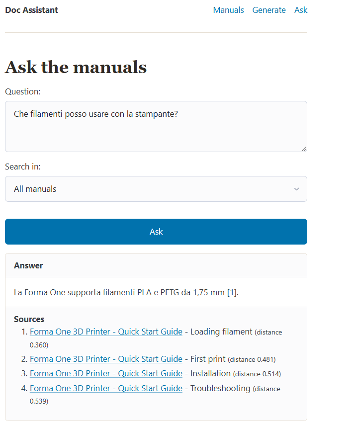
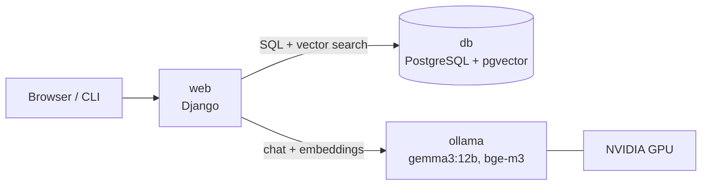

# Doc Assistant

An AI-powered assistant for technical documentation. It **writes user manuals** with a local large language model and **answers questions** about them using retrieval-augmented generation (RAG), citing the sections it used.

Everything runs locally in Docker: Django, PostgreSQL with pgvector, and Ollama on the GPU. No external API keys required.



## Features

- **Manual generation**: describe a product and the model writes a structured manual (title, description, sections), saved directly to the database.
- **Question answering (RAG)**: ask a question in natural language; the app finds the most relevant sections by meaning and the model answers using only those sources, with citations.
- **Grounded answers**: if no section is relevant enough, the app says so instead of making something up.
- **Multilingual**: manuals are written in English, but you can ask in any language and get the answer in that language.
- **Per-manual search**: restrict a question to a single manual to avoid mixing information from different products.
- **Web interface and CLI**: every feature is available both from the browser and as a Django management command.

## Tech stack

| Layer | Technology |
|---|---|
| Backend | Python 3.12, Django 5.2 |
| Database | PostgreSQL 17 with [pgvector](https://github.com/pgvector/pgvector) (HNSW index, cosine distance) |
| AI runtime | [Ollama](https://ollama.com), running on an NVIDIA GPU |
| Chat model | `gemma3:12b` |
| Embedding model | `bge-m3` (multilingual, 1024 dimensions) |
| Frontend | Django templates, [Pico CSS](https://picocss.com) |
| Infrastructure | Docker, Docker Compose |

## Architecture



Three services defined in `compose.yaml`:

- **web**: the Django application, built from the `Dockerfile`.
- **db**: PostgreSQL 17 with the pgvector extension; data is kept in a named volume.
- **ollama**: serves the language models on the GPU; downloaded models are kept in a named volume.

## How it works

### Manual generation

The model is called through Ollama's `/api/chat` endpoint with a **JSON schema** (structured outputs), so the response is always a JSON object with a title, a description and a list of sections. The result is validated, saved in a single database transaction and immediately indexed for search.

### Question answering (RAG)

1. Each section is converted into an **embedding** (a 1024-dimensional vector) with `bge-m3` and stored in PostgreSQL.
2. The question is embedded with the same model.
3. PostgreSQL ranks the sections by **cosine distance** to the question, using an HNSW index.
4. Sections above a distance threshold (`0.6`) are discarded. If none are left, the app answers that it could not find the information, without calling the model.
5. The remaining sections are numbered and passed to the chat model as sources, with instructions to answer **only** from them and cite them as `[1]`, `[2]`, ...

## Getting started

### Prerequisites

- [Docker Desktop](https://www.docker.com/products/docker-desktop/) (Windows/macOS) or Docker Engine with the Compose plugin (Linux).
- An NVIDIA GPU with recent drivers is recommended. On Linux you also need the [NVIDIA Container Toolkit](https://docs.nvidia.com/datacenter/cloud-native/container-toolkit/latest/install-guide.html).
- About 10 GB of free disk space for the models.

> **No GPU?** Remove the `deploy` block from the `ollama` service in `compose.yaml`. Everything still works on the CPU, just more slowly. A smaller chat model such as `qwen2.5:7b` is recommended in that case.

### Setup

```bash
git clone https://github.com/<your-username>/doc-assistant.git
cd doc-assistant
cp .env.example .env            # then set your own password

docker compose up --build -d

# Download the models (one time, about 9 GB)
docker compose exec ollama ollama pull gemma3:12b
docker compose exec ollama ollama pull bge-m3

# Create the database tables and an admin user
docker compose exec web python manage.py migrate
docker compose exec web python manage.py createsuperuser

# Load sample manuals and index them
docker compose exec web python manage.py seed_manuals
docker compose exec web python manage.py embed_sections
```

Open http://localhost:8000.

## Usage

### Web interface

| Page | URL | Description |
|---|---|---|
| Manuals | http://localhost:8000/ | List of manuals and reading view |
| Generate | http://localhost:8000/generate/ | Generate a new manual from a topic |
| Ask | http://localhost:8000/ask/ | Ask a question, optionally limited to one manual |
| Admin | http://localhost:8000/admin/ | Django admin to edit manuals and sections |

### Management commands

```bash
# Generate a manual and index it
docker compose exec web python manage.py generate_manual "automatic coffee machine with built-in grinder" --sections 4

# Ask a question (optionally in a single manual, with k sources)
docker compose exec web python manage.py ask "How do I reset the router?"
docker compose exec web python manage.py ask "Which filaments can I use?" --manual 1 --k 4

# Index sections without an embedding (or all of them with --all)
docker compose exec web python manage.py embed_sections

# Load sample data (--reset deletes all existing manuals first)
docker compose exec web python manage.py seed_manuals
```

## Configuration

All settings are read from environment variables in `.env` (see `.env.example`).

| Variable | Default | Description |
|---|---|---|
| `POSTGRES_DB` | `docassistant` | Database name |
| `POSTGRES_USER` | `docassistant` | Database user |
| `POSTGRES_PASSWORD` | - | Database password |
| `POSTGRES_HOST` | `db` | Database host (the Compose service name) |
| `OLLAMA_URL` | `http://ollama:11434` | Ollama API address |
| `OLLAMA_CHAT_MODEL` | `gemma3:12b` | Model used to write manuals and answers |
| `OLLAMA_EMBED_MODEL` | `bge-m3` | Model used to compute embeddings |

To switch models, pull the new model, change the variable and recreate the container with `docker compose up -d`.

## Project structure

```text
doc-assistant/
├── compose.yaml            # web, db and ollama services
├── Dockerfile              # image for the Django app
├── requirements.txt
├── .env.example
├── config/                 # Django project settings and URLs
└── manuals/
    ├── models.py           # Manual, Section (with vector embedding)
    ├── ai.py               # Ollama client: chat, embeddings, manual generation
    ├── rag.py              # indexing, semantic search, grounded answers
    ├── services.py         # logic shared by commands and views
    ├── forms.py, views.py, urls.py
    ├── templates/manuals/  # web pages
    ├── static/manuals/     # custom CSS
    ├── migrations/         # includes the migration that enables pgvector
    └── management/commands/
        ├── generate_manual.py
        ├── ask.py
        ├── embed_sections.py
        └── seed_manuals.py
```

## Design notes

- **Model choice**: `qwen2.5:7b` and `qwen2.5:14b` were tested first, but their output contained grammar mistakes and implausible details in Italian. `gemma3:12b` produced consistent, realistic text and fits entirely in 12 GB of VRAM.
- **Distance threshold**: in testing, relevant sections scored a cosine distance of about 0.25 to 0.45, while off-topic questions started around 0.72. The `0.6` threshold filters out irrelevant sources before they reach the model.
- **Per-manual filter**: with two manuals about the same product, the model could mix their information. Limiting the search to one manual avoids conflicting sources.
- **Logic separated from interfaces**: `services.py` and `rag.py` contain the logic; management commands and views are thin layers on top of them.

## Limitations and next steps

- Generation and answers run synchronously inside the request. A task queue (e.g. Celery or Django tasks) and streaming responses would improve the user experience.
- Sections are embedded as a whole; long documents would need chunking.
- No authentication on the public pages.
- Uses Django's development server; a production setup would use Gunicorn behind a reverse proxy.
- Automated tests and an evaluation set of questions to measure answer quality.

## License

[MIT](LICENSE)